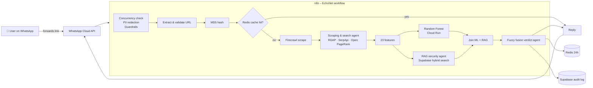

# EchoNet – WhatsApp Phishing Link Checker

> **Forward a link. Get a verdict.**
> EchoNet checks suspicious links right where people receive them: on WhatsApp. No app, no browser extension, no technical skills.

<p align="left">
  <a href="https://wa.me/27827719131?text=Hi"></a>
  
  
  
  
</p>

---

## Table of contents

- [The problem](#the-problem)
- [How to use EchoNet](#how-to-use-echonet)
- [Example reply](#example-reply)
- [Features](#features)
- [How it works](#how-it-works)
- [Verdict logic (fuzzy fusion)](#verdict-logic-fuzzy-fusion)
- [Technology stack](#technology-stack)
- [Repository structure](#repository-structure)
- [Setup and deployment](#setup-and-deployment)
- [Data model](#data-model)
- [Security and privacy](#security-and-privacy)
- [Testing](#testing)
- [Limitations](#limitations)
- [Roadmap](#roadmap)
- [Acknowledgements](#acknowledgements)
- [Disclaimer](#disclaimer)

---

## The problem

Phishing links reach people through WhatsApp, SMS, email and social media, often from **trusted contacts whose accounts have been hacked**. AI-generated clone pages now look identical to the real thing, so "checking whether it looks right" no longer works. Existing URL scanners need a browser, an app or technical skill, so most people never check a link at all.

EchoNet removes that barrier: if you can forward a WhatsApp message, you can check a link.

---

## How to use EchoNet

### 📱 WhatsApp number: **+27 82 771 9131**

1. Save **+27 82 771 9131** as a contact (e.g. *EchoNet*), or tap: **[wa.me/27827719131](https://wa.me/27827719131?text=Hi)**
2. Forward or paste the suspicious link into the chat.
   The link must be a full web address starting with `http://` or `https://`.
3. Wait a few seconds for your verdict:

| Verdict | Risk score | What to do |
|---|---|---|
| 🚨 **PHISHING** | 65–100% | Do **not** open the link or enter any passwords, OTPs or card details. |
| ⚠️ **SUSPICIOUS** | 35–64% | Be cautious. Only continue if you trust the sender. |
| ✅ **LEGITIMATE** | 0–34% | No phishing signs found, but always stay alert. |

**Tips**
- Send **one link at a time**. If a check is still running, EchoNet will ask you to wait.
- You don't need to include personal details. If you do, EchoNet removes ID numbers, card numbers and other personal information before anything is stored.
- A link checked in the last 24 hours gets an instant answer from the cache.

---

## Example reply

```
🚨 *PHISHING*
Risk score: *90%* (High risk)
🔗 https://fnb-rewards-za[.]top/claim
🎭 Possible impersonation of: *FNB*

Why:
• FNB login page on a non-FNB domain
• Domain registered 2 days ago
• Asks for OTP and card PIN

Do *not* open this link or enter any passwords, OTPs or card details.
```

*(Illustrative example of the reply format.)*

---

## Features

- **Works inside WhatsApp:** no installation, sign-up or technical skill needed.
- **Smart URL validation:** extracts up to 5 links from free text; rejects malformed links, private or internal addresses (SSRF protection) and dangerous schemes such as `javascript:`, `data:` and `file:`, with a specific, helpful reply for each case.
- **Hybrid detection:**
  - A **Random Forest** model scores the link's structure using 23 features.
  - A **RAG security agent** checks the page content against a phishing-detection knowledge base.
  - **Fuzzy fusion rules** combine both into one explainable verdict.
- **Explainable results:** every verdict shows the risk score, any brand being impersonated and up to three plain-language reasons.
- **Fast repeat checks:** a Redis cache (24-hour expiry) answers known links instantly.
- **Privacy first:** South African-specific PII redaction before storage or AI processing.
- **Abuse protection:** guardrails block jailbreak attempts and out-of-scope requests.
- **Graceful failure:** if a page can't be scraped or the ML service is unavailable, the user still gets a clear, cautious message.
- **Audit trail:** every completed scan is logged to Supabase for auditing and model retraining.

---

## How it works



### Step by step

1. **Receive:** the WhatsApp Cloud API delivers the message to the n8n workflow, and the request is recorded in the Conversation table.
2. **Check:**
   - Only one active request per user is allowed at a time.
   - PII is redacted.
   - Guardrails screen the message for jailbreak attempts.
   - The URL is extracted, normalised and validated.
3. **Recall:** an MD5 hash of the normalised URL is looked up in Redis. If there's a cache hit, the cached verdict is sent immediately.
4. **Scrape:** Firecrawl fetches the page (HTML, markdown, links, summary) in the cloud, never on the user's phone.
5. **Enrich:** an AI agent calls RDAP (domain age), SerpApi (Google index) and Open PageRank (domain rank).
6. **Analyse, in parallel:**
   - **Random Forest:** 23 features are sent to a FastAPI service on Google Cloud Run, which returns the prediction and phishing probability.
   - **RAG agent:** a Gemini-powered agent searches the Supabase threat knowledge base and returns a threat score, confidence, impersonated brand and indicators.
7. **Decide:** the fuzzy fusion agent combines both results into a 0–100 risk score and a verdict.
8. **Reply and store:** the verdict is sent on WhatsApp, cached in Redis for 24 hours and logged to Supabase.

### Knowledge base

The RAG agent searches a Supabase pgvector store loaded with a phishing-detection guide: URL forensics, browser clues, content red flags, mobile and QR phishing, advanced evasion tactics and verification habits. A scheduled **Threat Research Agent** (Perplexity Sonar Deep Research via OpenRouter) can add new phishing techniques to the knowledge base on a recurring schedule.

---

## Verdict logic (fuzzy fusion)

Both scores are first classed as **Low** (0.00–0.34), **Medium** (0.35–0.64) or **High** (0.65–1.00).

| ML level | RAG level | Output severity |
|---|---|---|
| High | High | High (90) |
| High | Medium | High (90) |
| High | Low | Moderate (50) |
| Medium | High | High (90) |
| Medium | Medium | Moderate (50) |
| Medium | Low | Low (12) |
| **Low** | **High** | **High (90)**: RAG override |
| Low | Medium | Low (12) |
| Low | Low | Low (12) |

- The RAG agent's influence is scaled by its **confidence**. Below 0.5, the ML model dominates. At 0.5 or above, the RAG agent can override the model. This catches new **AI-generated clone pages** whose URLs look normal.
- Score ≥ 65 → **PHISHING** · 35–64 → **SUSPICIOUS** · < 35 → **LEGITIMATE**.
- The fired rules are stored with every scan, so each verdict can be explained and audited.

---

## Technology stack

| Layer | Technology |
|---|---|
| User channel | WhatsApp Business Cloud API |
| Orchestration | [n8n](https://n8n.io) |
| Input security | n8n Guardrails (regex PII redaction, LLM jailbreak detection) |
| Cache | Redis (24-hour TTL) |
| Web scraping | [Firecrawl](https://firecrawl.dev) |
| Domain intelligence | RDAP (rdapapi.io), SerpApi, Open PageRank |
| Machine learning | scikit-learn Random Forest served by FastAPI on **Google Cloud Run (africa-south1)** |
| LLMs | Google Gemini (agents, guardrails, parsers); Perplexity Sonar Deep Research via OpenRouter (threat research) |
| Embeddings | OpenAI embeddings |
| Database and vector store | Supabase (PostgreSQL + pgvector, hybrid-search Edge Function, `ingest_phishing_scan` RPC) |
| Operational tables | n8n Data Tables: Conversation, Scapped Data, Failed Scapping |

---

## Repository structure

> Adjust this to match your repository.

```
echonet/
├── n8n/
│   └── EchoNet_Web_Page_Phishing_Detection.json   # n8n workflow export (no secrets)
├── ml-service/
│   ├── app/main.py            # FastAPI app: POST /predict
│   ├── model/model.joblib     # trained Random Forest
│   ├── requirements.txt
│   └── Dockerfile
├── supabase/
│   ├── schema.sql             # tables for scans, features, predictions, runs
│   ├── ingest_phishing_scan.sql
│   └── functions/hybrid_search/   # Edge Function for hybrid search
├── knowledge-base/
│   └── phishing-detection-guide.md
├── docs/
│   ├── architecture/          # component, deployment, class and sequence diagrams
│   └── testing/               # test cases and results
└── README.md
```

---

## Setup and deployment

### Prerequisites

- An n8n instance (n8n Cloud or self-hosted)
- A Meta developer account with a **WhatsApp Business** app and phone number
- A Google Cloud project with Cloud Run enabled
- A Supabase project
- A Redis instance
- API keys for Firecrawl, Google Gemini, OpenAI, OpenRouter, SerpApi, Open PageRank and RDAP API

### 1. Deploy the ML service (Google Cloud Run)

```bash
cd ml-service
gcloud run deploy ml-service \
  --source . \
  --region africa-south1 \
  --set-secrets API_KEY=echonet-ml-api-key:latest \
  --min-instances 0 --max-instances 3 \
  --memory 512Mi --cpu 1
```

The service exposes `POST /predict`. It accepts the 23-feature JSON object and returns `{ "prediction": "phishing" | "legitimate", "phishing_probability": 0.0–1.0 }`. Requests must include the `X-API-Key` header.

> Tip: for live demos, set `--min-instances 1` to avoid cold starts.

### 2. Set up Supabase

1. Enable the `pgvector` extension.
2. Run `supabase/schema.sql` to create the tables.
3. Run `supabase/ingest_phishing_scan.sql` in the SQL Editor. It creates the RPC called by the *Log Scan for Audit & Retraining* node.
4. Create the `documents` vector table and deploy the `hybrid_search` Edge Function.
5. Load the knowledge base: run the manual trigger path in n8n (*When clicking 'Execute workflow' → Data → Supabase Vector Store*).

### 3. Import the n8n workflow

1. In n8n, go to **Workflows → Import from file** and select `n8n/EchoNet_Web_Page_Phishing_Detection.json`.
2. Create these credentials and connect each one to its nodes:

| Credential | Used by |
|---|---|
| WhatsApp OAuth (trigger) | WhatsApp Trigger |
| WhatsApp API (send) | All *Send …* nodes |
| Redis | Get Cached URL, Cache Verdict |
| Firecrawl API | `/scrape` |
| Google Gemini (PaLM) API | Guardrails and all agents |
| OpenAI API | Embeddings |
| OpenRouter API | Threat Research Agent |
| SerpApi | Google index tool |
| Bearer auth: Open PageRank | page_rank tool |
| Bearer auth: RDAP API | domain_age tool |
| Header auth: `X-API-Key` | Machine Learning Model |
| Supabase API | Vector store, ingest RPC |

3. Update the Cloud Run URL in the **Machine Learning Model** node.
4. Create the n8n Data Tables: **Conversation**, **Scapped Data** and **Failed Scapping**.
5. In the Meta developer console, point the WhatsApp webhook to the n8n trigger URL.
6. Activate the workflow.

> ⚠️ Never commit API keys. Store every key in n8n's encrypted credential store, not in node fields or headers. If a key was ever committed, rotate it.

---

## Data model

Every completed scan is written to Supabase through the `ingest_phishing_scan` RPC:

| Table | Contents |
|---|---|
| `url_scans` | URL, status, source, timestamps |
| `char_count_features` | dots, `?`, `=`, `/`, `www` counts |
| `url_structure_features` | URL length, IP use, digit ratio, prefix/suffix |
| `host_features` | hostname length, digit ratio, TLD in subdomain |
| `word_features` | shortest/longest words, phishing hint words |
| `content_features` | hyperlinks, internal-link ratio, title checks |
| `reputation_features` | domain age, Google index, page rank |
| `ml_models` | model name, algorithm, version, accuracy |
| `predictions` | ML threat %, predicted status |
| `rag_assessments` | LLM model, threat %, explanation |
| `analysis_runs` | final threat %, verdict, rule that decided it |

The class, component and deployment diagrams are in `docs/architecture/`.

---

## Security and privacy

- **POPIA-aligned PII redaction:** before anything reaches an AI model, regex rules mask SA ID numbers, passport numbers, SARS income tax and VAT numbers, phone numbers, email addresses, card numbers, bank account numbers, and IP and MAC addresses.
- **Data minimisation:** temporary Conversation rows are deleted once a request completes. Long-term storage holds the URL and analysis results, not the user's message.
- **Local inference:** the ML model runs in Johannesburg (`africa-south1`).
- **Safe scanning:** pages are opened by Firecrawl in the cloud, never on the user's device. Private and internal addresses are rejected.
- **Credential handling:** all secrets are held in n8n's encrypted credential store and referenced by ID. The ML service requires an API key.
- **Abuse controls:** jailbreak guardrails and a one-active-request-per-user check.
- **Reliability:** failed scrapes and ML outages produce a friendly, cautious reply instead of silence, and the failures are logged.

---

## Testing

The test plan covers functional, integration, system and user acceptance testing. Key cases:

| ID | Input | Expected result |
|---|---|---|
| TC-01 | `Hi` | Prompt to send a full web address |
| TC-02 | `fnb.co.za/login` | `MISSING_SCHEME` message, with the link defanged |
| TC-03 | `javascript:alert(1)` | 🚨 dangerous link type warning |
| TC-04 | Same phishing URL twice | Second reply comes instantly from the cache |
| TC-05 | Live phishing URL (OpenPhish / PhishTank) | 🚨 PHISHING with brand and reasons |
| TC-13 | Second link sent during a scan | "Still resolving your previous request" |
| TC-14 | Unreachable site | Caution message, logged in Failed Scapping |
| TC-17 | Message containing an SA ID number | ID number masked, link still checked |
| TC-19 | `http://192.168.1.1/admin` | `PRIVATE_HOST` message |

Full results are in `docs/testing/`.

---

## Limitations

- **Cloaked pages:** pages behind CAPTCHAs, or pages that show bots harmless content, can't be fully scraped. Those verdicts rely more on URL structure and are less accurate.
- **External services:** EchoNet depends on third-party APIs (Firecrawl, Gemini, SerpApi, etc.), which add cost and latency.
- **Single channel:** EchoNet currently works on WhatsApp only.
- **Full URLs required:** links must include `http://` or `https://`.

---

## Roadmap

- [ ] "Was this verdict wrong?" feedback button that feeds monthly retraining on real South African phishing data
- [ ] SMS and email channels
- [ ] Replies in isiZulu, Afrikaans and other South African languages
- [ ] Visual similarity checks for brand clone detection
- [ ] Admin dashboard for scan volumes, threats and model performance

---

## Acknowledgements

- **Dataset:** Hannousse, A. & Yahiouche, S. (2021). *Web page phishing detection* dataset, used to train the Random Forest. Feature engineering follows the dataset's definitions and encodings.
- Threat statistics referenced in this project are from the SABRIC Annual Crime Statistics, ESET Threat Reports and APWG Phishing Activity Trends Reports.

---

## Disclaimer

EchoNet is a student research project that helps users assess links. It **does not guarantee** that a link is safe or malicious. Always verify important requests through official apps, websites or phone numbers, and never share passwords, OTPs or card details through a link you received in a message.

---

<p align="center"><b>EchoNet</b>: Phishing verdicts, delivered where people chat.<br>
📱 <a href="https://wa.me/27827719131?text=Hi">+27 82 771 9131</a></p>
